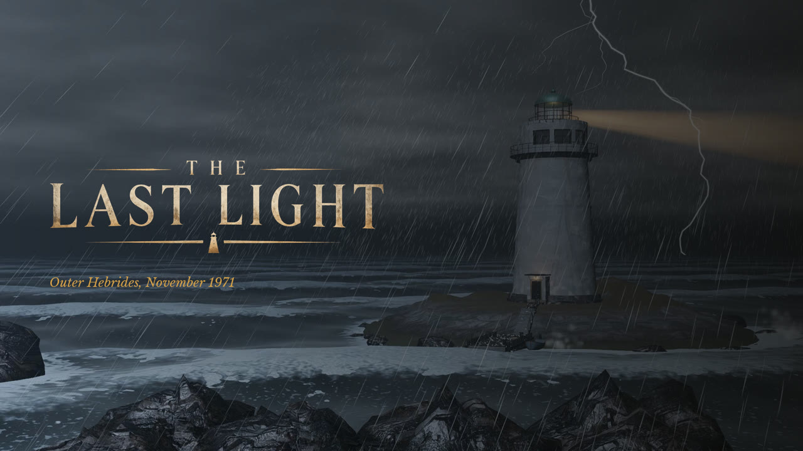
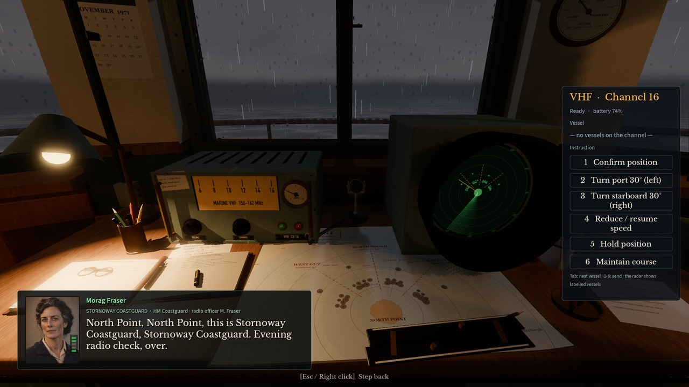
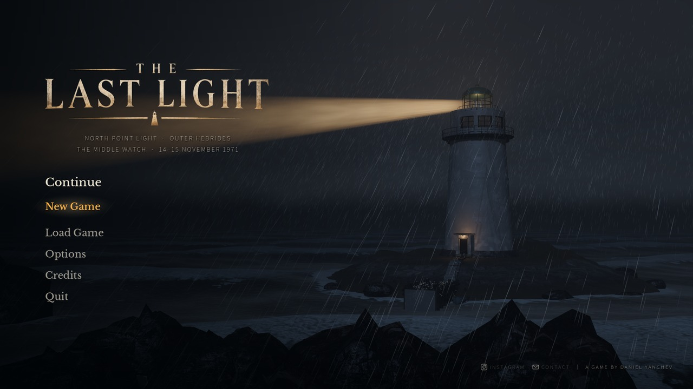
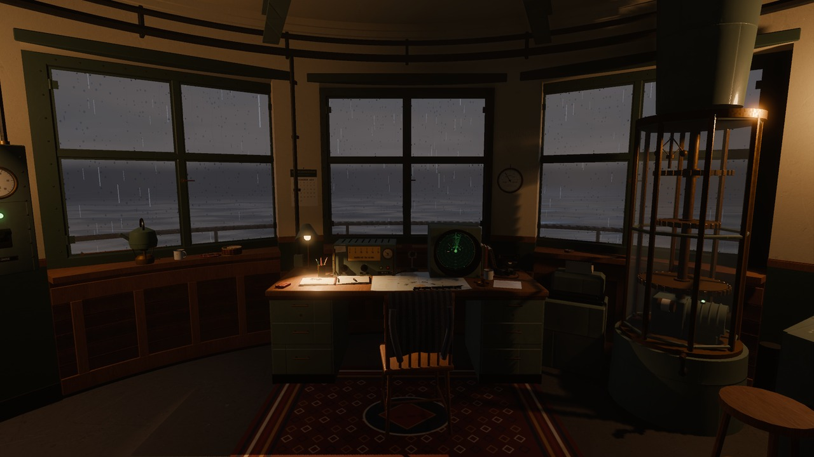
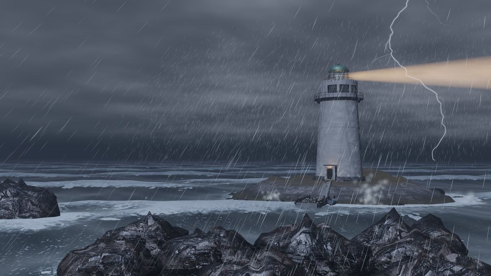
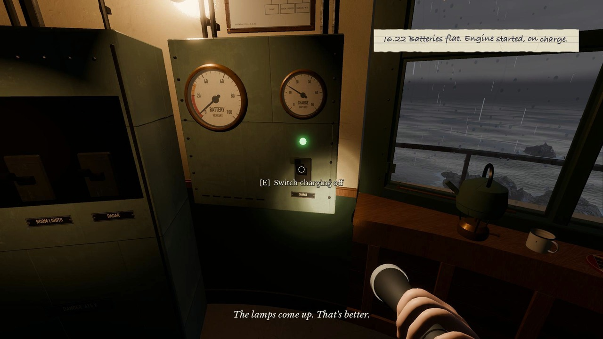
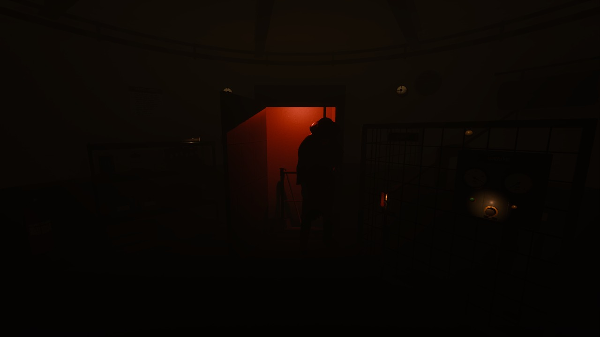
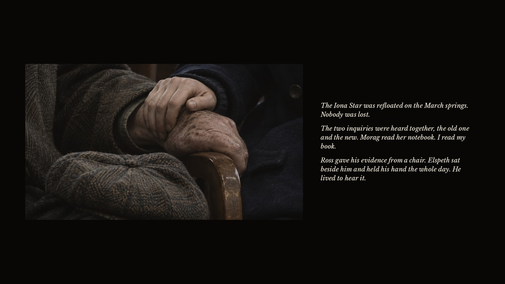

# The Last Light

**Нощта на 14 срещу 15 ноември 1971 г. над фар във Външните Хебриди бушува буря. Вие сте главният пазач Калъм Маккей и поддържате светлината, докато по радиото глас назовава траулер, потънал под този фар преди осемнайсет години.**

[**Гледай трейлъра**](https://dani-aisystems.github.io/the-last-light/trailer.html) · [**Изтегли играта**](https://github.com/dani-aisystems/the-last-light/releases/tag/v1.0.0) · [**Документация за конкурса**](competitions/john-atanasoff/README.md) · [**Разгледай изходния код**](projects/games/last_light/godot)

*Наративна игра от първо лице. Автор: Daniel Yanchev. Участие в Националния есенен турнир по информационни технологии „Джон Атанасов“ 2026/27.*

## За играта

- **Какво правите.** Една нощ в шест глави. Палите генератора, зареждате акумулаторите, пускате лампата и следите дали часовниковият ѝ механизъм се върти. По радиото и радара превеждате рибарски лодки през рифовете.
- **Какво решавате.** Говорите с хората по радиото и избирате какво да кажете. В шестте глави има около 110 възможни отговора. Краят зависи от това какво записвате в станционния дневник на разсъмване и дали ще преведете последния кораб.
- **Колко е голяма.** Четири края, 15 документа за четене, един играч, без интернет. Ориентировъчно време за едно изиграване: около 65–110 минути (типично около 80), без кредитите (още около 1–2 минути; пропускат се с Esc). Интерфейсът и текстовете са на английски; диалозите са текст със синтезиран звук на радиовръзка, без глас на актьори.
- **Къде работи.** macOS (изпитана) и Windows (експортирана, **не е изпитана** на Windows).

## Един момент от играта: вечерната проверка на радиото

В първата глава, когато станцията вече работи, бреговата охрана в Сторновей прави вечерна проверка. Радистката Мораг Фрейзър вика фара (долу вляво се вижда репликата ѝ), а вдясно е панелът на канал 16 с шестте заповеди, които давате на кораб: потвърди позиция, завой наляво или надясно, намали скорост, задръж, продължи по курс.

Разговорът с Мораг е същинска сцена с избор. Отговаряте например „Evening, Morag. You're early tonight.“ или само по устав. След това Мораг ви напомня каква дата е, а вие избирате между „I know what night it is, Morag.“, „Is it? I'd lost track.“ и „It's a Sunday. That's all it is.“. Играта запомня отношението ви към нея като число от −3 до 3 и го ползва по-късно: в последната глава една от репликите на Мораг зависи от него. Сцената е в [`ch1.dlg`](projects/games/last_light/godot/data/story/ch1.dlg) (реда с `== ch1_radio_check`). Кадърът показва точно началото ѝ, преди да се появят отговорите.

## Откъде да започнете

| Ако искате | Отворете |
|---|---|
| Да разберете играта за минута | [Трейлър, 1:17](https://dani-aisystems.github.io/the-last-light/trailer.html) |
| Да я изиграете | [Издание v1.0.0](https://github.com/dani-aisystems/the-last-light/releases/tag/v1.0.0) и инструкциите по-долу |
| Да прочетете конкурсната документация | [Материали за „Джон Атанасов“](competitions/john-atanasoff/README.md): [документация, 23 стр.](competitions/john-atanasoff/documentation/The_Last_Light_documentation_BG.pdf), [за печат, 5 стр.](competitions/john-atanasoff/documentation/The_Last_Light_documentation_print_5pages_BG.pdf), [диплянка](competitions/john-atanasoff/documentation/Leaflet_BG.pdf), [регламент](competitions/john-atanasoff/rules/Регламент%202026-2027.pdf) |
| Да разгледате техническата реализация | [Техническа реализация](#техническа-реализация) по-долу и [Godot проектът](projects/games/last_light/godot) |

## Как да играете

Всички файлове са в [изданието v1.0.0](https://github.com/dani-aisystems/the-last-light/releases/tag/v1.0.0). Контролните суми са в `SHA256SUMS.txt` до тях.

**macOS** (macOS 11 или по-нова на Apple silicon; 10.15 или по-нова на Intel с Metal; около 400 MB място):

1. Изтеглете `TheLastLight-macOS.zip` и го разархивирайте.
2. Щракнете двукратно върху „The Last Light“. macOS ще каже, че не може да провери приложението, защото то не е заверено (нотаризирано) от Apple. Натиснете **Done** (не „Move to Bin“).
3. Отворете **System Settings > Privacy & Security**, слезте до „Security“ и натиснете **Open Anyway** до „The Last Light was blocked“. Потвърдете с парола.
4. Играта се отваря и оттук нататък се стартира нормално.

**Windows** (64-битов Windows 10 или 11, видеокарта с Vulkan 1.2 или Direct3D 12). Изданието не е изпитвано на Windows:

1. Изтеглете `TheLastLight-Windows.zip` и го разархивирайте в собствена папка.
2. Стартирайте `TheLastLight.exe`. Ако SmartScreen покаже „Windows protected your PC“, изберете **More info**, после **Run anyway** (програмата не е подписана).

**Основно управление** (пълният списък и геймпадът са в [`README_EN.md`](projects/games/last_light/release/R7/docs/README_EN.md)):

| Действие | Клавиш |
|---|---|
| Оглеждане / ходене | Мишка / W A S D |
| Използване, вдигане, отговор по радиото | E или ляв бутон на мишката |
| Избор на отговор в разговор | 1 до 4 |
| Радиозаповед към кораб / следващ кораб | 1 до 6 / Tab |
| Текуща задача (задръжте за подсказка) | J |
| Дневник на станцията | L |
| Стъпка назад, пауза | Esc (пауза и с P) |
| Цял екран | F11 |

Играта се записва автоматично; „Continue“ в началния екран продължава от същото място. Настройките за достъпност (размер и скорост на текста, ниво на помощ, намаляване на проблясъците) са в Options.

## Техническа реализация

Играта е направена с [Godot Engine 4.7.2](https://godotengine.org/) (GDScript). Ресурсите (стаята на фара, самият фар, документите, циферблатите) са създадени със скриптове на Python, които управляват Blender 5.2, и са внесени в Godot като GLB. Три конкретни неща, които можете да проследите в кода:

**1. Историята е данни, а изборът променя състоянието.** Диалозите са текстови `.dlg` файлове. Парсерът [`dialogue_db.gd`](projects/games/last_light/godot/scripts/story/dialogue_db.gd) разпознава реплики, отговори (`* текст -> етикет`), условия (`[if …]`) и действия (`! add rel.morag 1`). Действията се прилагат в [`StoryState.apply_action`](projects/games/last_light/godot/scripts/story/story_state.gd), а условията се оценяват с `StoryState.eval` чрез `Expression` на Godot. Така за нова реплика или разклонение не е нужна промяна в кода. Историята е в [`data/story/`](projects/games/last_light/godot/data/story) (`ch1.dlg` до `ch6.dlg` и `chapters.json`).

**2. Записът и възстановяването на прогреса.** `StoryState.to_dict` / `from_dict` описват историята (глава, флагове, улики, отношения, завършени разговори), а [`game_fp.gd`](projects/games/last_light/godot/scripts/fp/game_fp.gd) (`save_dict`, `_apply_save`) добавя симулацията на станцията, позицията на играча, вратата и музиката. [`save_system.gd`](projects/games/last_light/godot/scripts/save_system.gd) пише във временен файл и го преименува, пази копие на предишния автозапис, отхвърля повреден запис без срив и мигрира стари версии. Старите записи се проверяват от [`save_compat_test.gd`](projects/games/last_light/godot/tests/save_compat_test.gd).

**3. Един източник на истина за геометрията и автоматична проверка на ресурсите.** Размерите и цветовете на стаята и фара са в [`blender/spec.py`](projects/games/last_light/blender/spec.py). [`pipeline.sh`](projects/games/last_light/blender/pipeline.sh) строи сцената в Blender, валидира я (брой триъгълници, материали, трансформации), експортира, зарежда експорта обратно и го синхронизира с Godot. Станцията (генератор, акумулатори, лампа) е симулация в [`keeper_sim.gd`](projects/games/last_light/godot/scripts/core/keeper_sim.gd), а тестове в [`godot/tests/`](projects/games/last_light/godot/tests) (в това число бот, който достига всичките четири края) се пускат без графика.

Измерено на Apple M3: в предварително избраното качество Medium кадърът отнема 16,6 до 18,0 ms (медиана); High е по-тежко (25,5 до 27,7 ms). Подробностите и тестовете са в [документацията](competitions/john-atanasoff/documentation/The_Last_Light_documentation_BG.pdf).

## Снимки

| Заглавният екран | Стаята на фара, залез | Бурята отвън |
|---|---|---|
|  |  |  |

| Таблото на станцията | Посетителят при вратата | Епилог (един от четирите края) |
|---|---|---|
|  |  |  |

Всички кадри са заснети в играта, във високо качество и без обработка. Опис: [`SCREENSHOTS.md`](projects/games/last_light/release/R7/SCREENSHOTS.md).

## Как да отворите проекта от изходния код

Нужен е Godot Engine **4.7.2** (безплатен, [godotengine.org](https://godotengine.org/)). Има два начина:

- **Архивът с пълния проект (препоръчително).** Изтеглете `TheLastLight-source.zip` от [изданието](https://github.com/dani-aisystems/the-last-light/releases/tag/v1.0.0), проверете `SHA256SUMS.txt`, разархивирайте и отворете папката `godot/` в Godot. Натиснете Import, после Run. Така големите файлове са налични без Git LFS.
- **Клониране.** Нужен е [Git LFS](https://git-lfs.com/): `git lfs install`, после `git clone https://github.com/dani-aisystems/the-last-light.git`. Без LFS големите файлове (`.blend`, `.glb`, `.fbx`, текстури, музика) остават указатели и сцените няма да се заредят. Отворете `projects/games/last_light/godot` в Godot 4.7.2.

Проверка от терминал: `godot --headless --path projects/games/last_light/godot -s res://tests/run_tests.gd` (също `story_test.gd`, `opening_test.gd`).

Структура на хранилището: играта е в [`projects/games/last_light/`](projects/games/last_light) (`godot/` е проектът за Godot, `blender/` са скриптовете и `.blend` файловете, `audio/` е звуковата работа, `release/` е подготовката на изданието); [`competitions/john-atanasoff/`](competitions/john-atanasoff) е за конкурса; останалото (`scripts/`, `tools/`, `docs/`) е общата работна среда за Blender, в която играта е направена ([описание](docs/WORKSPACE_README.md)).

## Автор, кредити и ресурси

**A game by Daniel Yanchev**, както е записано в кредитите на самата игра (виждат се след края и от „Credits“ в началния екран). Разпределението на ролите е в Декларацията (Приложение 4) на автора.

- **Свободни ресурси (CC0 1.0):** текстури от [Poly Haven](https://polyhaven.com/), базови човешки мрежи от Blender Studio (за ръцете и тялото на пазача) и записани звуци от [Freesound](https://freesound.org/). Списъкът с автори и лицензите е в [`assets/ASSET_LICENSES.md`](assets/ASSET_LICENSES.md) и в `THIRD_PARTY_LICENSES.txt` до играта.
- **Подготвени с външни инструменти** (записано в [`DECISIONS.md`](docs/architecture/DECISIONS.md), решения Q11, Q13, Q16, Q28): портретите на радиоперсонажите и деветте крайни картини са изображения, подготвени от автора; музиката е създадена от автора с музикална услуга по абонамент; гласът на разказвача в трейлъра е синтезиран (ElevenLabs, безплатен план). В самата игра няма озвучаване с глас. Точната формулировка за конкурса е в Декларацията (Приложение 4) на автора.
- **Шрифтове:** SIL Open Font License 1.1 (Libre Baskerville, Source Sans 3, Courier Prime, Cedarville Cursive).
- Героите, корабите, фарът North Point Light и събитията от 1953 г. са измислени.

## Състояние и ограничения

- **Изпитано:** macOS на един Mac с Apple M3; автоматични тестове (в документацията: `regress_test` 503/503, `run_tests` 95/95 и други).
- **Не е изпитано:** изданието за Windows на компютър с Windows; Mac с Intel; други видеокарти.
- **Изчислено, не измерено с хронометър:** времето за пълно преминаване. Ориентировъчно време за едно изиграване: около 65–110 минути (типично около 80), без кредитите (още около 1–2 минути; пропускат се с Esc). Методът е в [`METHOD.md`](competitions/john-atanasoff/build/playtime/METHOD.md).
- Приложението за macOS не е нотаризирано, затова първото стартиране има допълнителна стъпка (виж по-горе).

## Лиценз

Хранилището е с лиценз MIT ([`LICENSE`](LICENSE)). Ресурсите на трети страни запазват собствените си лицензи (виж „Автор, кредити и ресурси“).
